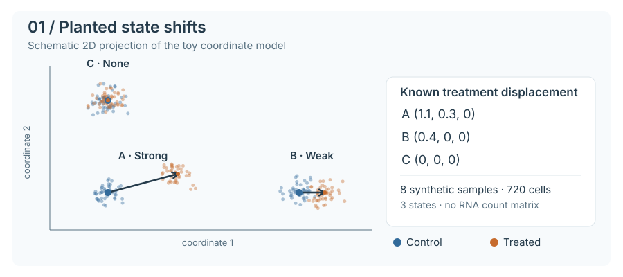
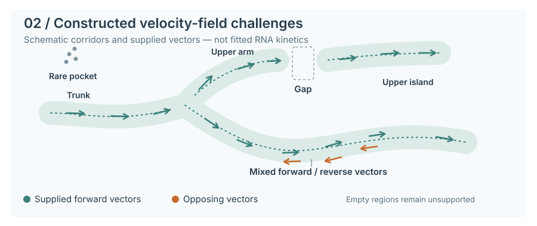
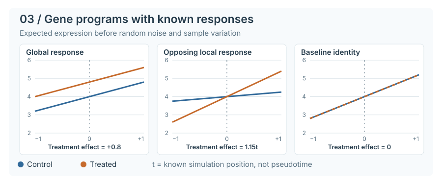
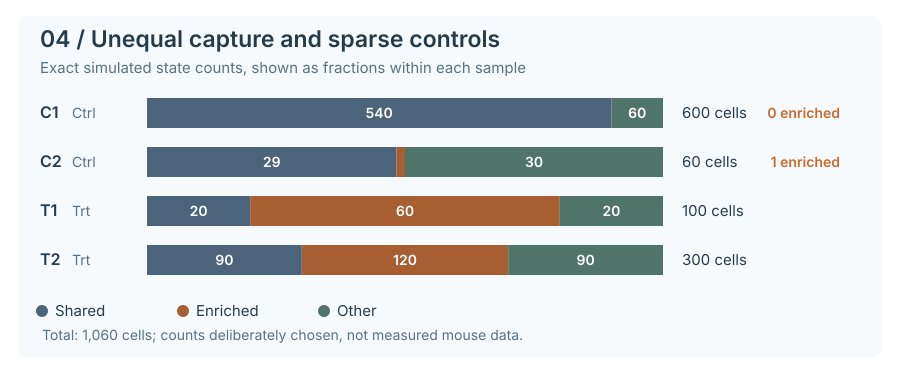

# How the tutorial data are generated

**A visual introduction to ScGeo 0.2.0 simulations**

[Start here](START_HERE.md) · [Run the tutorials](../notebooks/tutorials/v0.2.0/README.md) · [Exact generator sources](../scripts/scgeo_v020_examples/README.md)

Every default tutorial from 00 to 10 generates its own **fully synthetic input** at runtime. No experimental mouse or human samples, raw sequencing files, or manuscript data are required. Lesson 11 is the optional exception: it can use explicitly supplied, checksum-matched public PBMC3k or pancreas AnnData files.

Why simulate? When the expected shift, expression response or support failure is known in advance, it is easier to understand what ScGeo should recover — and what it should refuse to infer.

The figures on this page explain the input designs. The first two are schematics, the expression curves are exact noiseless model functions, and the composition bars use exact planted counts. None is a biological result or a substitute for the actual notebook exports.

## 1. Generate geometry directly

In lessons [01](../notebooks/tutorials/v0.2.0/01_robust_shift_report.ipynb) and [02](../notebooks/tutorials/v0.2.0/02_representation_and_contrasts.ipynb), the toy generators construct state clouds directly in a three-dimensional coordinate space rather than simulate thousands of genes and then embed them.

A cell coordinate is generated by adding four components:

$$
\mathbf{x}_{i,s,k,c} = \boldsymbol{\mu}_k + \mathbf{b}_s
+ a_c\boldsymbol{\Delta}_k + \boldsymbol{\epsilon}_i
$$

| Component | Meaning |
| --- | --- |
| $\boldsymbol{\mu}_k$ | Baseline center of state $k$ |
| $\mathbf{b}_s$ | Random offset shared by all cells from synthetic sample $s$ |
| $a_c\boldsymbol{\Delta}_k$ | Planted displacement in condition $c$ |
| $\boldsymbol{\epsilon}_i$ | Random cell-level noise |

The [quickstart generator](../scripts/scgeo_v020_examples/quickstart.py) uses seed 7, four independent synthetic sample identities per condition, three states and 30 cells per state per sample: **720 cells**. Sample offsets have standard deviation 0.12 per coordinate; cell noise has standard deviation 0.22. The control strength is zero and the treated strength is one.

| State | Planted treated-minus-control vector | Expected contrast |
| --- | --- | --- |
| A | (1.1, 0.3, 0) | Larger shift |
| B | (0.4, 0, 0) | Smaller shift |
| C | (0, 0, 0) | No planted shift |

The estimated displacement need not equal the planted displacement exactly because samples and cells have random offsets. The state C estimate need not be numerically zero. The point is to inspect magnitude, direction and sample variability rather than assume that every visible movement is a true effect.

The [comparison gallery generator](../scripts/scgeo_v020_examples/plotting_gallery.py) adds a third condition (mild, strength 0.45), uses a slightly different set of planted 3D effects, records supplied velocity vectors and constructs a rotated copy of the same coordinates. The rotation is a **dependent sensitivity check**, not an independent measurement of biological robustness.

Both examples keep a placeholder expression matrix in AnnData. The analysis is performed on the quantitative coordinates in obsm, not on a simulated RNA count matrix. Display coordinates in the comparison gallery are the first two quantitative coordinates, not a fitted UMAP.

Lesson [00](../notebooks/tutorials/v0.2.0/00_input_contract.ipynb) uses a smaller deterministic four-sample design with shared, sparse, control-only and tiny states. It checks input coverage and enumerates the six possible assignments of four independent samples to two groups of two. Cells are not independent experimental replicates. See the [input-contract generator](../scripts/scgeo_v020_examples/deployment_smoke.py).

## 2. Constructed topology and velocity fields

Lessons [03](../notebooks/tutorials/v0.2.0/03_paga_shift_maps.ipynb) and [04](../notebooks/tutorials/v0.2.0/04_velocity_fields.ipynb) introduce anisotropic state clouds, branched landscapes and curved corridors. Their purpose is to challenge graph and field visualization under known conditions.

The [PAGA generator](../scripts/scgeo_v020_examples/paga_shift_map_gallery.py) plants eight state centers, state-specific shifts, rotated noise clouds, unequal capture and a treated-only state in the target contrast. The graph connectivity weights are supplied explicitly. A third context condition tests whether a requested control-versus-treated plot improperly incorporates unrelated observations.

The [velocity-field generator](../scripts/scgeo_v020_examples/velocity_field_gallery.py) samples positions along analytic curves, adds noise along and across each curve, and assigns vectors along their tangents. Treatment changes the location, vector speed and direction. Deliberate challenges include:

- A true empty region, across which a streamline should not invent support.
- A lower-corridor patch with mixed forward and reverse vectors.
- A rare pocket with too few neighbors for the chosen field-support threshold.
- An overlapping third condition with large reversed vectors, outside the requested contrast.

Neither generator performs Scanpy PAGA inference or scVelo RNA-velocity fitting. A constructed graph is not an inferred lineage; a tangent vector is not a measured transcriptional rate. The actual ScGeo plotting code is tested using known supplied inputs.

## 3. Simulate molecular responses, not just coordinates

Lesson [08](../notebooks/tutorials/v0.2.0/08_shift_explanations.ipynb) generates a continuous expression matrix with **1,350 cells, 18 features and 12 independent synthetic samples** (six per condition). Each sample has 90, 99, 108, 117, 126 or 135 cells. Seed 37 gives reproducible sample and cell noise.

The [molecular generator](../scripts/scgeo_v020_examples/explain_shift_gallery.py) assigns cells a known position $t$ approximately spanning −1 to +1, with small random jitter. Early and late groups are defined by the sign of that position.

| Program | Features | Planted behavior |
| --- | ---: | --- |
| Response | 3 | Same +0.8 treatment effect at all positions |
| LocalResponse | 3 | Treatment effect changes sign with position |
| Identity | 3 | Baseline position dependence; no condition effect |
| SampleVariation | 3 | Additional shared sample-level variation |
| Null | 6 | Noise and sample offsets; no planted condition effect |

The three noiseless functions shown above are:

| Program | Control expression | Treated expression |
| --- | --- | --- |
| Response | $4 + 0.8t$ | $4 + 0.8t + 0.8$ |
| LocalResponse | $4 + 0.25t$ | $4 + 1.4t$ |
| Identity | $4 + 1.2t$ | $4 + 1.2t$ |

The local response is especially instructive:

$$
\Delta E_{\mathrm{local}}(t) = 1.15t
$$

The early region decreases and the late region increases. Their effects can nearly cancel when averaging over the whole state. A conventional global pseudobulk contrast can therefore miss this pattern; the local ScGeo analysis can retain the opposite signs when the groups have sufficient coverage. This does not imply that every pseudobulk strategy fails — appropriately stratified or interaction-aware analyses can also address heterogeneous effects.

Unlike the geometric fixtures, this example fits an actual eight-component PCA to the simulated expression matrix using scikit-learn and stores the exact affine loadings:

~~~python
pca = PCA(n_components=8, svd_solver="full")
adata.obsm["X_pca"] = pca.fit_transform(adata.X)
adata.varm["PCs"] = pca.components_.T.copy()
~~~

ScGeo then computes the sample-aware robust shift and checks the supplied feature-to-coordinate map. Signed gene contributions account for the displacement along its observed direction; their agreement with the known planted responses is informative but does not establish causal regulation. The expression matrix contains continuous arbitrary units, not sequenced counts. The simulation coordinate is not inferred pseudotime, and the curve axis in the default ScGeo plot is a geometric shift coordinate, not necessarily the simulator's $t$.

### Two small counterexamples

The same example source contains two additional controlled cases:

| Case | Known construction | Lesson |
| --- | --- | --- |
| Composition-only change | Late-state fraction changes from 25% to 75%; within-region expression is identical | A parent-state shift can arise entirely from changing mixture proportions |
| Joint-distribution change | Control points (0,0), (2,2); treated points (0,2), (2,0) | The marginal expression distributions and mean center are unchanged, yet the joint geometry differs |

These are reasons to separate displacement, local response, composition and distributional change rather than combine them into a single driver score.

## 4. A condition-enriched state with almost no controls

Lessons [09](../notebooks/tutorials/v0.2.0/09_sparse_states.ipynb) and [10](../notebooks/tutorials/v0.2.0/10_stored_compass.ipynb) use a deliberately difficult four-sample simulation with **1,060 cells, six features and three states**.

The [sparse-state generator](../scripts/scgeo_v020_examples/condition_sparse_states_gallery.py) specifies these counts directly (seed 83 for expression and coordinate noise):

| Sample | Shared | Enriched | Other | Total | Enriched frequency |
| --- | ---: | ---: | ---: | ---: | ---: |
| C1 | 540 | 0 | 60 | 600 | 0% |
| C2 | 29 | 1 | 30 | 60 | 1.67% |
| T1 | 20 | 60 | 20 | 100 | 60% |
| T2 | 90 | 120 | 90 | 300 | 40% |

These are artificial counts, not measurements from any original mouse experiment. Unequal sample capture is intentional. The enriched state's control frequency, averaged equally across the two samples, is about 0.83%; its treated frequency is 50%. A raw-cell pie uses 1 control versus 180 treated enriched cells, whereas a sample-abundance pie normalizes the two condition mean frequencies to sectors. They answer different questions.

The six expression features combine state identity, treatment effects, baseline variation and noise:

| Feature | Simulated role |
| --- | --- |
| Ieg1 | Enriched-state identity and treatment response |
| Response2 | Additional enriched-state and treatment response |
| Identity1 | Depends on horizontal synthetic position |
| Identity2 | Depends on vertical synthetic position |
| Housekeeping | Constant baseline plus random variation |
| Background | Small baseline-dependent variation |

For example, Ieg1 is generated as

$$
E = 3 + 1.5 I_{\mathrm{enriched}} + 0.70 I_{\mathrm{treated}}
+ 0.25 b + u_s + \epsilon
$$

where $b$ is the synthetic cell's baseline score, $u_s$ is a shared sample offset and $\epsilon$ is cell-level expression noise. The generator fits a four-component PCA to the expression and keeps independently constructed display coordinates.

This fixture illustrates an important distinction:

- A zero-cell sample has zero observed state abundance if its denominator is positive, but **no observed expression** in that state.
- A singleton provides an observed expression value, not a reliable control profile or interval.
- A pooled graph node and composition pie can remain visible even when the within-state shift comparison is unsupported.
- A broader parent grouping can be analyzed separately, but its shift may mix changing state composition with within-state molecular changes.

The [compass generator](../scripts/scgeo_v020_examples/compass_evidence_gallery.py) reuses the sparse-state fixture, adds supplied vectors and illustrative OOD scores (including one state with missing scores), and calls the actual robust-shift and representation-stability APIs. The compass reads those stored results and distinguishes supported estimates from unavailable comparisons. Its alignment does not establish a recovery mechanism.

## 5. Which input does each tutorial use?

| Lesson | Input construction | What it teaches |
| --- | --- | --- |
| 00 — Input contract | Deterministic coordinates and uneven sample coverage | Coverage, correct sampling unit and six assignments |
| 01 — Robust shift | Three Gaussian state clouds with planted displacement | Robust estimates and sample-level uncertainty |
| 02 — Representation | Toy 3D coordinates, rotated copy and supplied vectors | Sensitivity, contrasts and separate evidence layers |
| 03 — PAGA | Eight anisotropic clouds and constructed topology | Graph display and selected-condition scope |
| 04 — Velocity | Noisy analytic corridors and tangent vectors | Local support, gaps and opposing directions |
| 05 — Associations and density | Synthetic coordinates and same-cell artificial annotations | Annotation associations, not lineage; density and legacy plots |
| 06 — Facets and composition | Synthetic state/batch/condition coordinates and vectors | Matched axes and scales, composed figures |
| 07 — Atlas | Toy geometry, supplied graph and computed report | Combine available evidence without fabricating missing inputs |
| 08 — Shift explanations | Continuous expression with known gene programs; fitted PCA | Signed attribution and local response |
| 09 — Sparse states | Four unequal samples and a rare-control state; fitted PCA | Observed expression and distinct composition denominators |
| 10 — Compass | Same sparse-state fixture, supplied vectors and stored ScGeo results | Evidence availability, coverage and display invariance |
| 11 — Optional public data | Explicitly supplied checksum-matched PBMC3k/pancreas | Descriptive rendering of actual public inputs |

See the [complete notebook index](../notebooks/tutorials/v0.2.0/README.md) for the runnable lessons and their environment.

## 6. What does this validate?

| Evidence level | Purpose and boundary |
| --- | --- |
| **Controlled tutorial simulations (this guide)** | Inspect known geometric and molecular constructions, software correctness, export integrity and edge cases. |
| **More realistic single-cell simulation (possible extension)** | Generate counts with realistic depth and sparsity, multiple biological samples, nonlinear differentiation, regulation and splicing dynamics; benchmark recovery after preprocessing. Not part of the current tutorial series. |
| **Experimental biological validation** | Test hypotheses on measured perturbation datasets with appropriate replication, independent evidence or interventions. Tutorial success alone does not establish causal mechanisms or biological generalization. |

The companion's existing [frozen benchmarks](../notebooks/benchmarks/README.md) and [published evidence](RESULTS_OVERVIEW.md) are separate from these teaching fixtures. Their designs, metrics and inferential limits are documented in their own workflows. For a future count-level simulation extension, the relevant questions are whether a method recovers planted effects after realistic preprocessing, remains calibrated under null and mixture-only scenarios, and retains uncertainty across biological samples. The present tutorials do not claim that validation.

## Inspect the actual generators

After installing the [independent 0.2.0 tutorial environment](../notebooks/tutorials/v0.2.0/README.md), run this from the companion repository root:

~~~python
import sys
from pathlib import Path

sys.path.insert(0, str(Path("scripts/scgeo_v020_examples").resolve()))
from explain_shift_gallery import make_example_data

adata, programs, cell_truth, feature_truth = make_example_data(seed=37)
print(adata.shape)  # (1350, 18)
print(feature_truth.to_string(index=False))
print(adata.obs.groupby(["condition", "sample"], observed=True).size())
~~~

Try a different seed on a fresh object to see how the sampled estimates vary without changing the planted model. Do not edit the copied release generators in place: the runner validates their Git blob identities. Keep modified examples in a separate scratch location.

The source snapshots correspond to [ScGeo v0.2.0](https://github.com/liuifrec/scgeo/tree/46ba9017ceef17255292edd0140602ed13ac5305), source commit 46ba9017ceef17255292edd0140602ed13ac5305. The tutorial environment uses the published package; the local example files preserve the exact generator code from that release. Output notebooks and plots are created locally, leaving the original manuscript checkpoints unchanged.

**Next:** [Run the tutorial series](../notebooks/tutorials/v0.2.0/README.md), or read the package's [analysis-layer guide](https://github.com/liuifrec/scgeo/blob/v0.2.0/docs/ANALYSIS_LAYERS.md).
