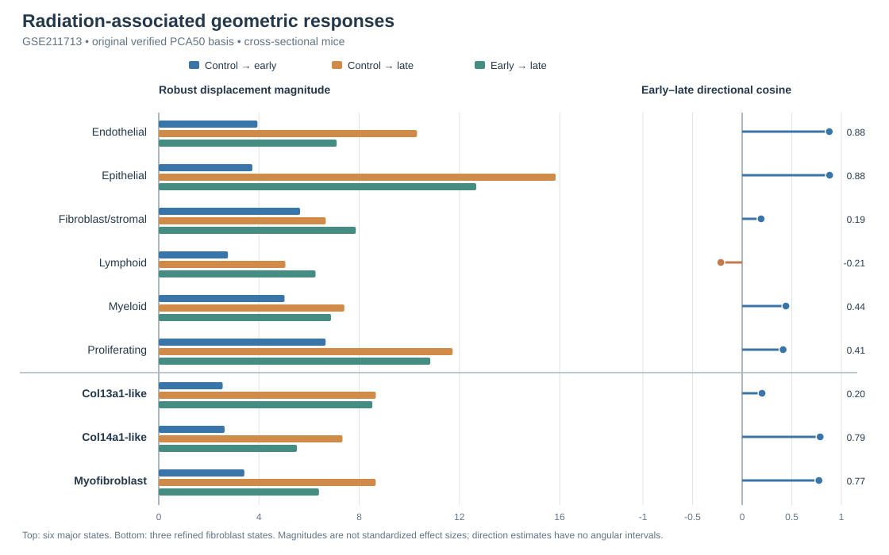
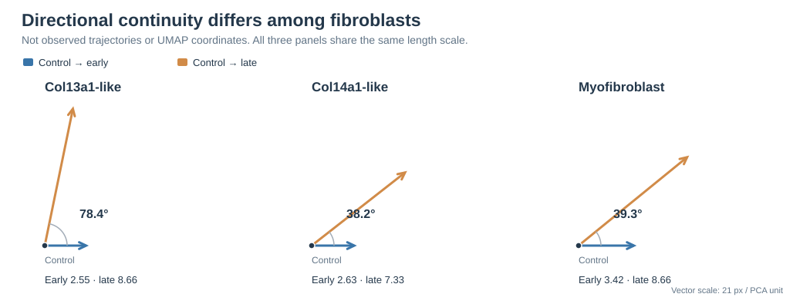
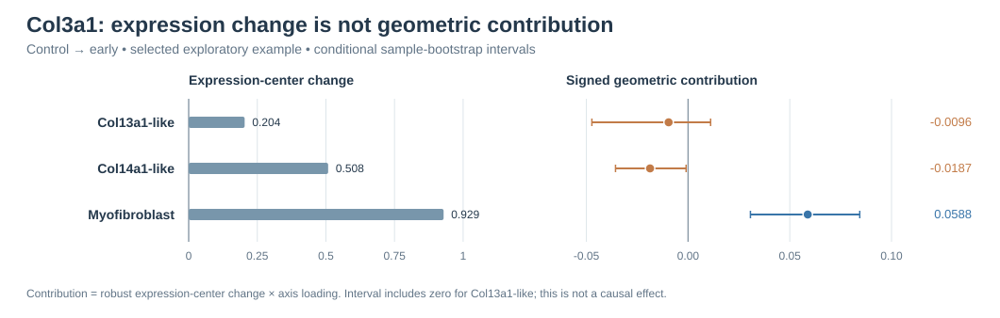
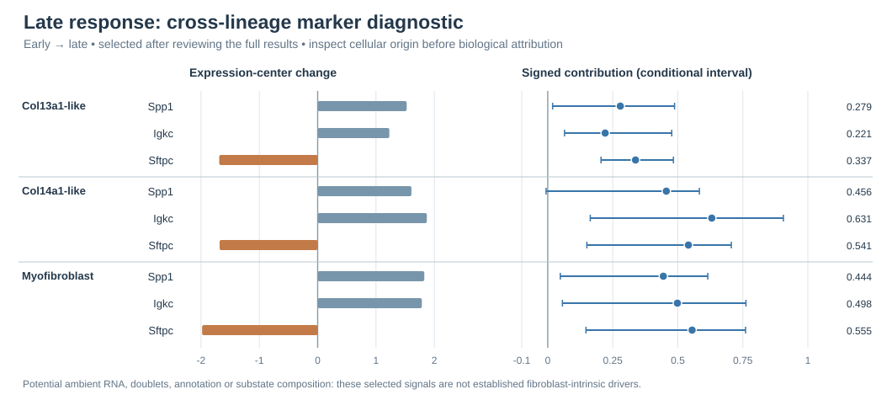
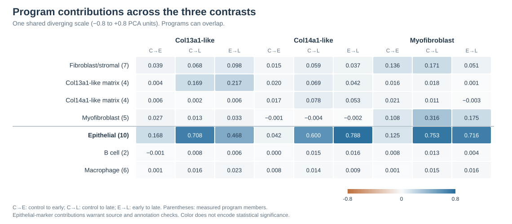
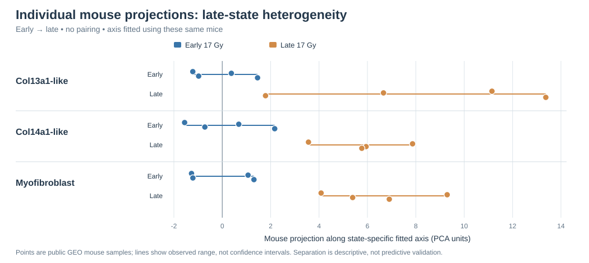

# GSE211713 — molecular shift explanations on real public data

[**Open the results-first notebook**](GSE211713_fibroblast_results.ipynb) · [Original GEO study](https://www.ncbi.nlm.nih.gov/geo/query/acc.cgi?acc=GSE211713) · [Full molecular workflow (tested commit)](https://github.com/liuifrec/scgeo-notebooks/blob/3bc5472defaa6cee8d11edfe49659c072c887117/notebooks/applications/v0.2.0/07_gse211713_shift_explanations.ipynb)

This gallery is derived from the maintainer's actual ScGeo 0.2.1 run, not synthetic data. All 27 state/contrast explanations passed. Browse the figures directly here or open the notebook to inspect the numerical tables without downloading the original H5ADs. The full analysis remains separate from this curated viewer.

The original corrected v2 representation contains 131,157 retained cells; the primary cross-sectional groups use 5 control, 4 early 17 Gy and 4 late 17 Gy mice. Original sample qualification, verified PCA50 coordinates, and molecular mapping are retained. The state hierarchies overlap. Nothing here establishes causal drivers, temporal trajectories or independent biological validation.

## Geometry: direction and magnitude



[Open full-size SVG](figures/01_geometry.svg)



[Open full-size SVG](figures/02_direction.svg)

## Molecular accounting



[Open full-size SVG](figures/03_col3a1.svg)

Positive expression change need not have a positive geometric contribution. The intervals are conditional on the observed axis; these selected examples are retrospective.



[Open full-size SVG](figures/04_late_markers.svg)

The late Spp1, Igkc and Sftpc signals need cellular-origin and annotation checks. They are not established fibroblast-intrinsic responses.



[Open full-size SVG](figures/05_programs.svg)

Overlapping program sums are not an additive partition or enrichment score.

## Biological replicate context



[Open full-size SVG](figures/06_mouse_scores.svg)

The fitted-axis separation is descriptive, not independently validated prediction; no mouse pairing is implied.

## Reproduce and audit

The compact [selected_results.json](selected_results.json) contains 27 complete state-contrast summary rows, nine derived directional cosines, 18 selected gene rows (with conditional intervals), 63 selected program rows and 24 public GEO mouse projection rows. Selected numeric fields were rounded to nine decimal places; all plots use this compact snapshot. The original archive is not committed. Source run: molecular workflow at commit `3bc5472defaa6cee8d11edfe49659c072c887117`, ScGeo 0.2.1 candidate `683228b1c52808d3cc5df2de5f6e104932c29328`, uploaded review archive SHA256 `5560cc696876e2ab04c6424871dbe8fbf1dc9ac3bbebb5d5bfe22dd46fd92393`. Snapshot SHA256 `ce27992692852941726a13ada2b896f8a468aeb824896b308a1e4df45569c331`. Full mapping residual (reported) 0.00019633187917378336, original threshold 0.0003353477565126075; no refit. The full gene tables were checked during extraction, but only the selected rows and derived cosine summaries are included here.

From repository root, install `pandas nbformat nbclient ipykernel` in an isolated Python environment and execute the viewer with Jupyter. The viewer uses no ScGeo installation or external dataset. The deterministic static figure generator requires Node.js:

```bash
node scripts/render_public_lung_gallery.mjs --check
```

If you have the exact original local review archive, run:

```bash
python scripts/extract_public_lung_gallery.py /path/to/GSE211713_molecular_review.tar.gz --check notebooks/applications/results/gse211713/selected_results.json
```

This read-only comparison checks the complete snapshot; it will refuse a different archive. All original-feature matching and derived directional cosine computations are documented in the extractor. For the companion pooled HSPC example, see the [GSE249479 results gallery](../gse249479/README.md).
