# GSE211713 — native ScGeo 0.2.1 outputs

[Native results notebook](GSE211713_native_results.ipynb) · [Geometry workflow](../../../v0.2.0/05_gse211713_radiation_response.ipynb) · [Molecular workflow](../../../v0.2.0/07_gse211713_shift_explanations.ipynb) · [Aggregate molecular gallery](../README.md) · [GEO dataset](https://www.ncbi.nlm.nih.gov/geo/query/acc.cgi?acc=GSE211713)

131,157 retained mouse-lung cells; the primary cross-sectional contrasts use 13 qualified mice (5 control, 4 early, 4 late).

16 selected unchanged native figure exports from 83 original plot bundles. The candidate commit is `683228b1c52808d3cc5df2de5f6e104932c29328`. The collector verified all original figure and source-table hashes locally; published files are selected native images and exact plot metadata, not custom redraws. The complete [inventory and provenance](gallery_manifest.json) records source commits and hashes; unselected figures and full plot source tables remain local.

Geometry API examples selected by documented names; first complete gene/program/connector triplet in each selected contrast; selected for software coverage, not biological significance.

Geometry panels use the original stored representations and descriptive graph adjacency, not inferred transitions. Molecular contributions are signed accounting on the verified original linear basis, not causal drivers. Curves and connectors are not temporal trajectories; any intervals or ranges retain the original sample scope.

## primary condition facets

`scgeo.pl.embedding_facets` — Common display-only UMAP; all retained cells in primary mice

[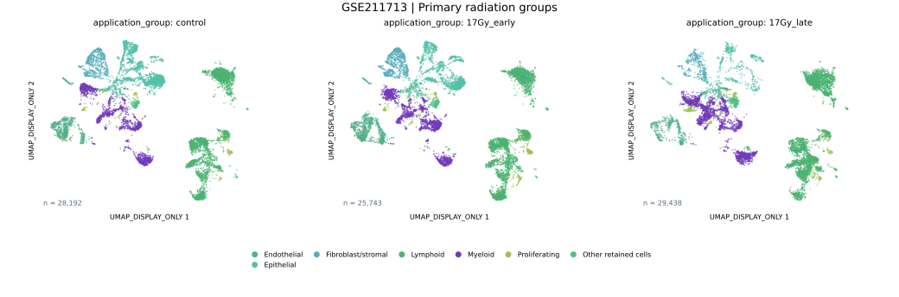](figures/geometry/primary_condition_facets.svg)

[Full-size original figure](figures/geometry/primary_condition_facets.svg) · [Original plot metadata](metadata/geometry/primary_condition_facets.json)

## fibroblast facets

`scgeo.pl.embedding_facets` — Fibroblast display subset only; never use this subset as total retained-cell denominator

[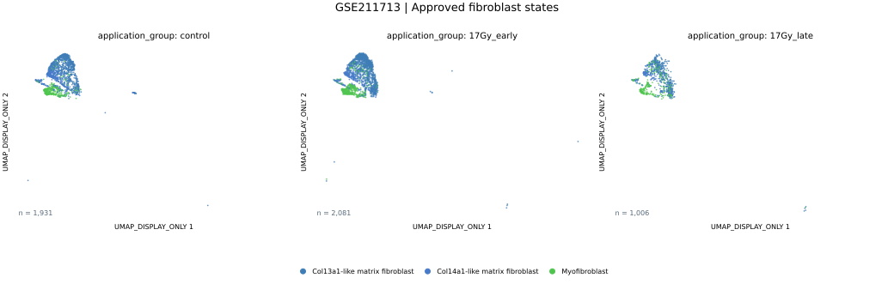](figures/geometry/fibroblast_facets.svg)

[Full-size original figure](figures/geometry/fibroblast_facets.svg) · [Original plot metadata](metadata/geometry/fibroblast_facets.json)

## relative density

`scgeo.pl.embedding_density` — Relative embedding density, not sample abundance

[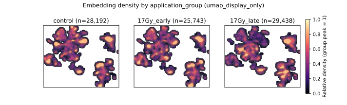](figures/geometry/relative_density.svg)

[Full-size original figure](figures/geometry/relative_density.svg) · [Original plot metadata](metadata/geometry/relative_density.json)

## major control vs 17gy early evidence

`scgeo.pl.state_evidence_panel` — Frozen qualified-mouse displacement; cross-sectional

[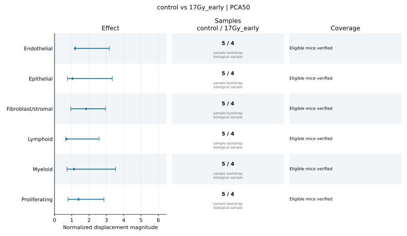](figures/geometry/major_control_vs_17gy_early_evidence.svg)

[Full-size original figure](figures/geometry/major_control_vs_17gy_early_evidence.svg) · [Original plot metadata](metadata/geometry/major_control_vs_17gy_early_evidence.json)

## major control vs 17gy late representation matrix

`scgeo.pl.robustness_matrix` — Stored scalar magnitudes; representations not independent

[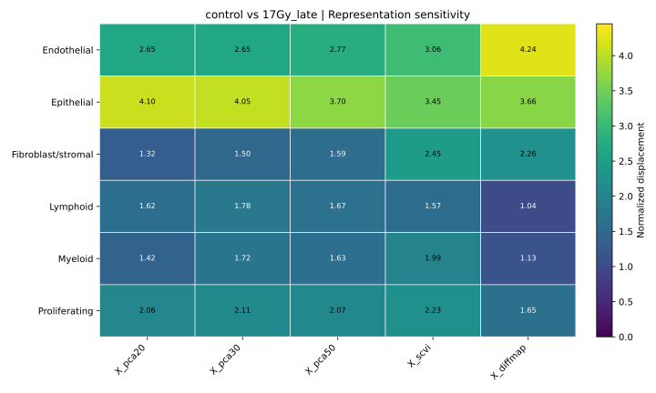](figures/geometry/major_control_vs_17gy_late_representation_matrix.svg)

[Full-size original figure](figures/geometry/major_control_vs_17gy_late_representation_matrix.svg) · [Original plot metadata](metadata/geometry/major_control_vs_17gy_late_representation_matrix.json)

## major control vs 17gy late composition pies

`scgeo.pl.paga_shift_map` — PAGA-style renderer of descriptive pooled neighbor adjacency, not PAGA inference; equal-mouse state frequencies within condition

[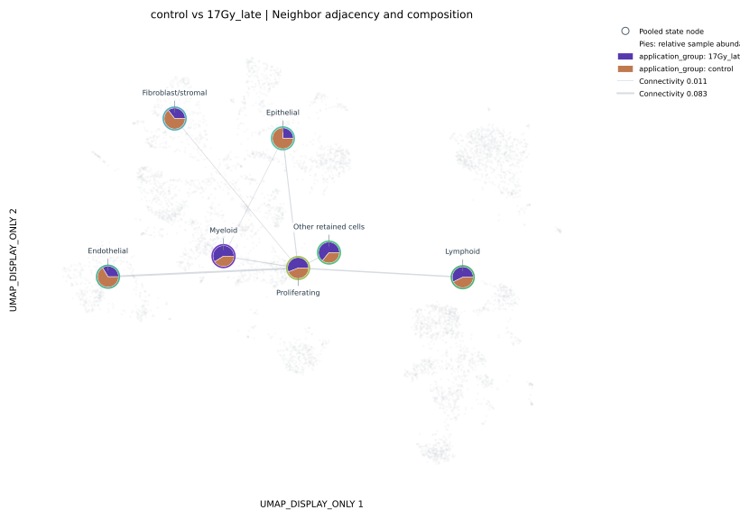](figures/geometry/major_control_vs_17gy_late_composition_pies.svg)

[Full-size original figure](figures/geometry/major_control_vs_17gy_late_composition_pies.svg) · [Original plot metadata](metadata/geometry/major_control_vs_17gy_late_composition_pies.json)

## major control vs 17gy late compass

`scgeo.pl.recovery_compass` — Frozen qualified-mouse displacement; cross-sectional; alignment/OOD absent; connectors show display means, not quantitative displacements; graph is descriptive adjacency

[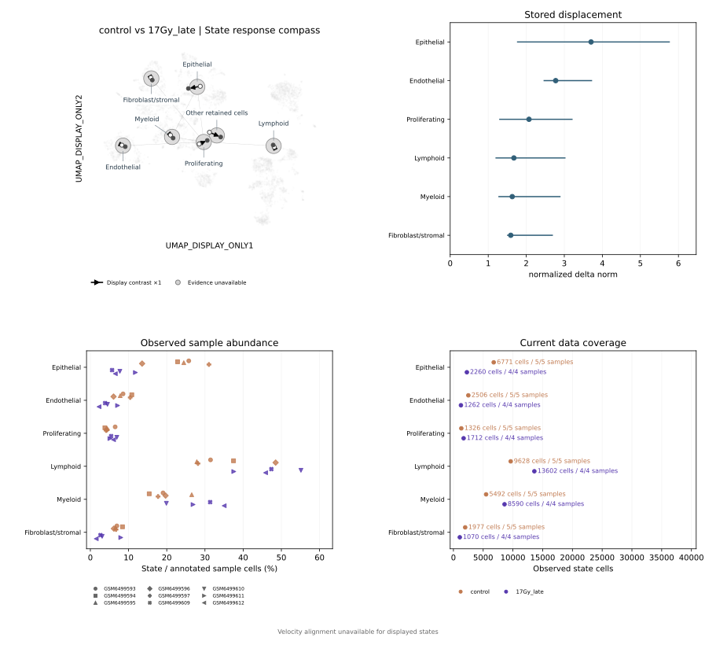](figures/geometry/major_control_vs_17gy_late_compass.svg)

[Full-size original figure](figures/geometry/major_control_vs_17gy_late_compass.svg) · [Original plot metadata](metadata/geometry/major_control_vs_17gy_late_compass.json)

## major control vs 17gy late mouse centers

`scgeo.pl.replicate_effect` — Frozen qualified mouse centers; PC1 is one coordinate only; cross-sectional, unpaired

[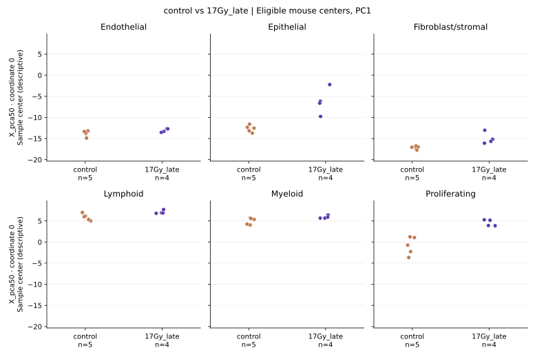](figures/geometry/major_control_vs_17gy_late_mouse_centers.svg)

[Full-size original figure](figures/geometry/major_control_vs_17gy_late_mouse_centers.svg) · [Original plot metadata](metadata/geometry/major_control_vs_17gy_late_mouse_centers.json)

## major control vs 17gy late atlas

`scgeo.pl.geometry_dynamics_atlas` — Frozen sample-aware evidence and display-only states; no dynamics

[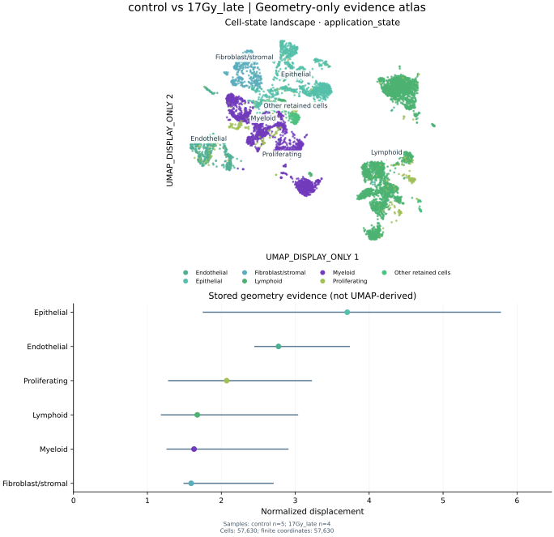](figures/geometry/major_control_vs_17gy_late_atlas.svg)

[Full-size original figure](figures/geometry/major_control_vs_17gy_late_atlas.svg) · [Original plot metadata](metadata/geometry/major_control_vs_17gy_late_atlas.json)

## fibroblast 17gy early vs late compass

`scgeo.pl.recovery_compass` — Frozen qualified-mouse displacement; cross-sectional; alignment/OOD absent; connectors show display means, not quantitative displacements; graph is descriptive adjacency

[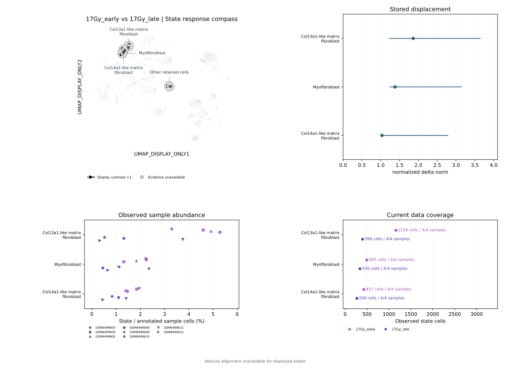](figures/geometry/fibroblast_17gy_early_vs_late_compass.svg)

[Full-size original figure](figures/geometry/fibroblast_17gy_early_vs_late_compass.svg) · [Original plot metadata](metadata/geometry/fibroblast_17gy_early_vs_late_compass.json)

## C fibroblast control vs 17gy early 00 gene curves

`scgeo.pl.shift_curves` — Qualified cross-sectional mice; conditional sample bootstrap and sample-range curves; verified_frozen_pca50_coordinates; geometric accounting, not causal regulation; mapping policy: verified_global_residual_recenter_bound

[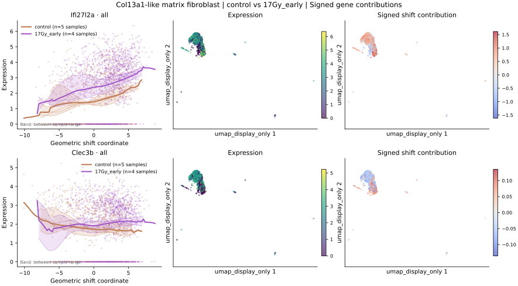](figures/molecular/C_fibroblast_control_vs_17gy_early_00_gene_curves.svg)

[Full-size original figure](figures/molecular/C_fibroblast_control_vs_17gy_early_00_gene_curves.svg) · [Original plot metadata](metadata/molecular/C_fibroblast_control_vs_17gy_early_00_gene_curves.json)

## C fibroblast control vs 17gy early 00 program curves

`scgeo.pl.shift_curves` — Qualified cross-sectional mice; conditional sample bootstrap and sample-range curves; verified_frozen_pca50_coordinates; geometric accounting, not causal regulation; mapping policy: verified_global_residual_recenter_bound; overlapping program sums are not percentages

[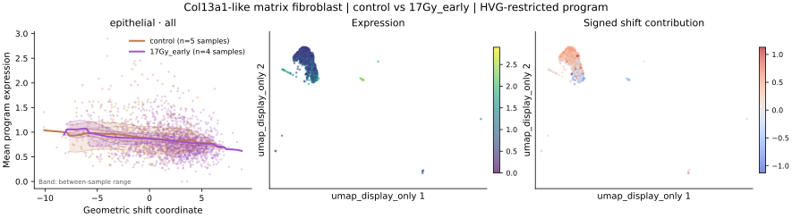](figures/molecular/C_fibroblast_control_vs_17gy_early_00_program_curves.svg)

[Full-size original figure](figures/molecular/C_fibroblast_control_vs_17gy_early_00_program_curves.svg) · [Original plot metadata](metadata/molecular/C_fibroblast_control_vs_17gy_early_00_program_curves.json)

## C fibroblast control vs 17gy early 00 shift embedding

`scgeo.pl.shift_embedding` — Qualified cross-sectional mice; conditional sample bootstrap and sample-range curves; verified_frozen_pca50_coordinates; geometric accounting, not causal regulation; mapping policy: verified_global_residual_recenter_bound; connector is not a lineage or RNA velocity

[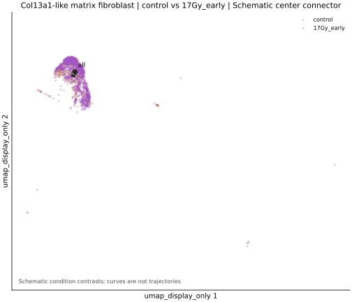](figures/molecular/C_fibroblast_control_vs_17gy_early_00_shift_embedding.svg)

[Full-size original figure](figures/molecular/C_fibroblast_control_vs_17gy_early_00_shift_embedding.svg) · [Original plot metadata](metadata/molecular/C_fibroblast_control_vs_17gy_early_00_shift_embedding.json)

## C fibroblast control vs 17gy late 00 gene curves

`scgeo.pl.shift_curves` — Qualified cross-sectional mice; conditional sample bootstrap and sample-range curves; verified_frozen_pca50_coordinates; geometric accounting, not causal regulation; mapping policy: verified_global_residual_recenter_bound

[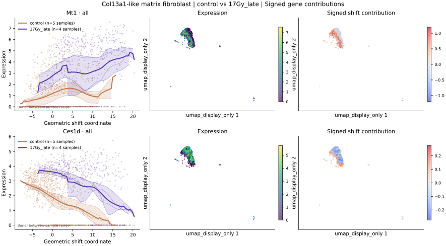](figures/molecular/C_fibroblast_control_vs_17gy_late_00_gene_curves.svg)

[Full-size original figure](figures/molecular/C_fibroblast_control_vs_17gy_late_00_gene_curves.svg) · [Original plot metadata](metadata/molecular/C_fibroblast_control_vs_17gy_late_00_gene_curves.json)

## C fibroblast control vs 17gy late 00 program curves

`scgeo.pl.shift_curves` — Qualified cross-sectional mice; conditional sample bootstrap and sample-range curves; verified_frozen_pca50_coordinates; geometric accounting, not causal regulation; mapping policy: verified_global_residual_recenter_bound; overlapping program sums are not percentages

[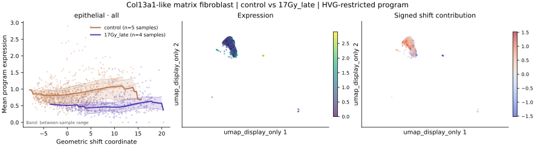](figures/molecular/C_fibroblast_control_vs_17gy_late_00_program_curves.svg)

[Full-size original figure](figures/molecular/C_fibroblast_control_vs_17gy_late_00_program_curves.svg) · [Original plot metadata](metadata/molecular/C_fibroblast_control_vs_17gy_late_00_program_curves.json)

## C fibroblast control vs 17gy late 00 shift embedding

`scgeo.pl.shift_embedding` — Qualified cross-sectional mice; conditional sample bootstrap and sample-range curves; verified_frozen_pca50_coordinates; geometric accounting, not causal regulation; mapping policy: verified_global_residual_recenter_bound; connector is not a lineage or RNA velocity

[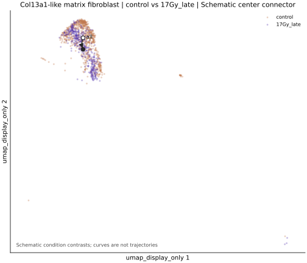](figures/molecular/C_fibroblast_control_vs_17gy_late_00_shift_embedding.svg)

[Full-size original figure](figures/molecular/C_fibroblast_control_vs_17gy_late_00_shift_embedding.svg) · [Original plot metadata](metadata/molecular/C_fibroblast_control_vs_17gy_late_00_shift_embedding.json)

