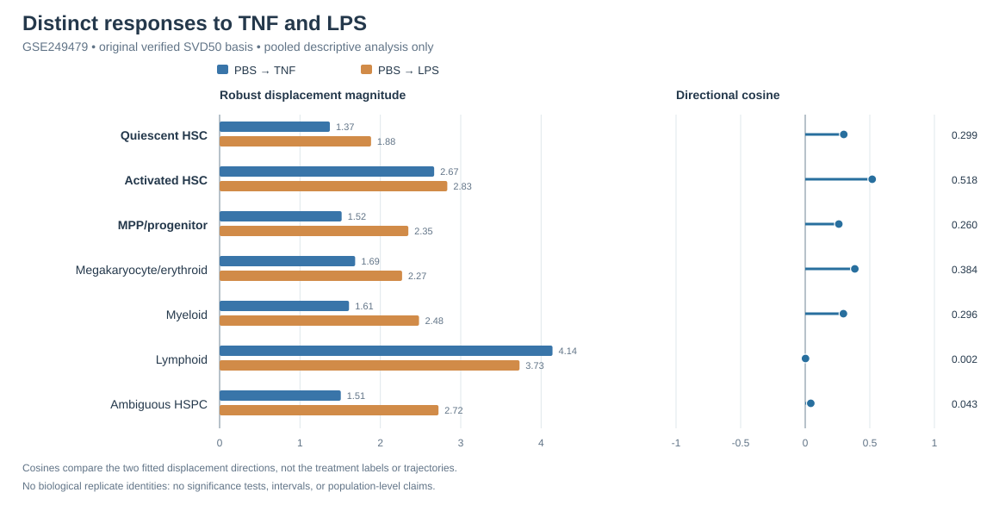
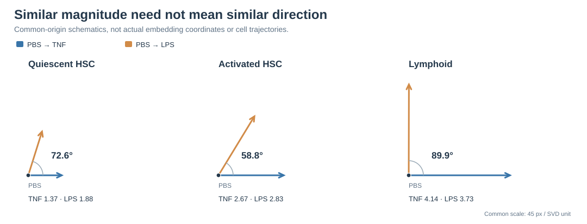
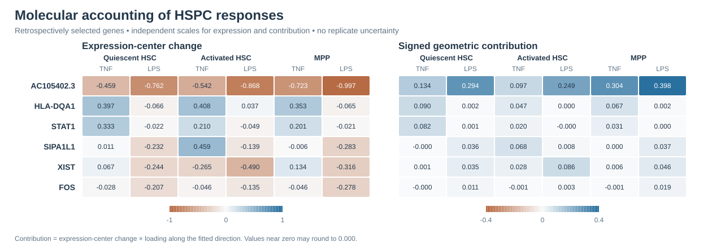
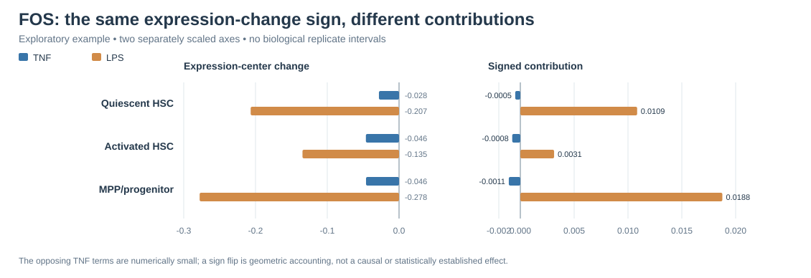
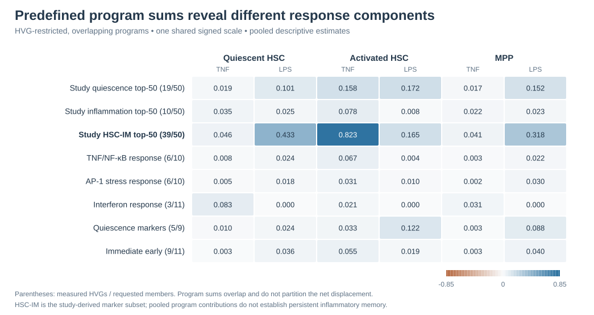

# GSE249479 — public HSPC molecular shift results

[**Open the results-first notebook**](GSE249479_inflammation_results.ipynb) · [Original GEO dataset](https://www.ncbi.nlm.nih.gov/geo/query/acc.cgi?acc=GSE249479) · [Full molecular workflow](../../v0.2.0/06_gse249479_shift_explanations.ipynb) · [Replicate-aware lung gallery](../gse211713/README.md)

This is a lightweight viewer of the actual successful ScGeo 0.2.1 HSPC molecular run, not synthetic data. All 14 state/contrast entries completed on the frozen 3,000-HVG SVD50 basis for 34,432 retained cells. The input contains no usable biological-replicate identities, so all estimates are pooled descriptive accounting with status `insufficient_samples`. No pseudo-replicates, sample intervals or population-level inference are introduced.

## Geometry



[Open full-size SVG](figures/01_geometry.svg)



[Open full-size SVG](figures/02_direction.svg)

The two perturbations have different directions even when their magnitudes are similar. The arrows are schematics of fitted vectors, not observed cell trajectories.

## Molecular explanations



[Open full-size SVG](figures/03_genes.svg)



[Open full-size SVG](figures/04_fos.svg)

Gene selection is retrospective. In particular, XIST is a reason to investigate sample composition, not an established perturbation-specific molecular driver. The same sign of expression change need not imply the same contribution sign.



[Open full-size SVG](figures/05_programs.svg)

These program sums overlap and are restricted to measured HVGs. The HSC-IM marker subset and other program names preserve the original definitions; they do not establish acquired or persistent memory, causal pathway activation, or differential-expression significance.

## Reproduce and audit

[selected_results.json](selected_results.json) contains all 14 state/contrast summaries, seven directional cosine summaries, 36 selected gene rows, and all 252 program contribution estimates. Program coverage includes 169 matched of 359 requested membership entries across the original 19 programs; 18 meet the minimum membership requirement. The excluded apoptosis program has one measured gene. The 28 exported pooled-center rows are **not** treated as sample replicates and are not distributed.

Source: successful B molecular run at companion commit `84bb5b1f20f168e7e95237825a803409f44a474e`, ScGeo 0.2.1 candidate `683228b1c52808d3cc5df2de5f6e104932c29328`. Original review archive SHA256 `0a3ccd640df283558bcba766f735e8304b9a316190955329819c819ac249b227`. Snapshot SHA256 `11457cf462777afc82cf123a89c8d4408b964a254980637b4d8d66646853dcf4`. Values in the compact rows are rounded to nine decimal places. All 42,000 gene contributions and 252 program sums were independently audited against the exported tables; the reported original mapping residual is 0.000028037035832539914 against threshold 0.00014492281041546384. The original cell expression/coordinate matrix is not part of this review archive, so the mapping residual was not independently remeasured.

From repository root, install `pandas nbformat nbclient ipykernel` in an isolated Python environment and execute the notebook with Jupyter. For static snapshots:

```bash
node scripts/render_public_hspc_gallery.mjs --check
```

If you have the exact source archive, reproduce the compact extraction (read-only):

```bash
python scripts/extract_public_hspc_gallery.py /path/to/GSE249479_molecular_review.tar.gz --check notebooks/applications/results/gse249479/selected_results.json
```

The complete exported gene-axis vectors are required to recompute the directional cosines. The original H5ADs and raw expression are needed to reproduce the full mapping and ScGeo shift curves; the figures in this gallery are aggregate-data visualizations rather than substitute cell-level curves.
