# GSE249479 — native ScGeo 0.2.1 outputs

[Native results notebook](GSE249479_native_results.ipynb) · [Geometry workflow](../../../v0.2.0/04_gse249479_inflammation.ipynb) · [Molecular workflow](../../../v0.2.0/06_gse249479_shift_explanations.ipynb) · [Aggregate molecular gallery](../README.md) · [GEO dataset](https://www.ncbi.nlm.nih.gov/geo/query/acc.cgi?acc=GSE249479)

34,432 retained human HSPCs; pooled descriptive comparisons without verified biological replicate identities.

14 selected unchanged native figure exports from 34 original plot bundles. The candidate commit is `683228b1c52808d3cc5df2de5f6e104932c29328`. The collector verified all original figure and source-table hashes locally; published files are selected native images and exact plot metadata, not custom redraws. The complete [inventory and provenance](gallery_manifest.json) records source commits and hashes; unselected figures and full plot source tables remain local.

Geometry API examples selected by documented names; first complete gene/program/connector triplet in each selected contrast; selected for software coverage, not biological significance.

Geometry panels use the original stored representations and descriptive graph adjacency, not inferred transitions. Molecular contributions are signed accounting on the verified original linear basis, not causal drivers. Curves and connectors are not temporal trajectories; any intervals or ranges retain the original sample scope.

## condition facets

`scgeo.pl.embedding_facets` — Fixed frozen UMAP for display

[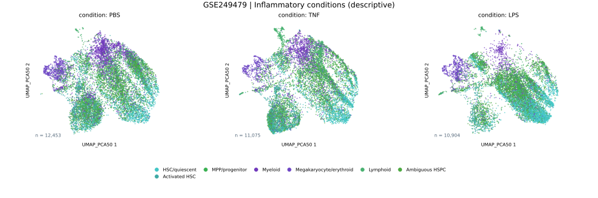](figures/geometry/condition_facets.svg)

[Full-size original figure](figures/geometry/condition_facets.svg) · [Original plot metadata](metadata/geometry/condition_facets.json)

## relative density

`scgeo.pl.embedding_density` — Descriptive density shape, not absolute abundance

[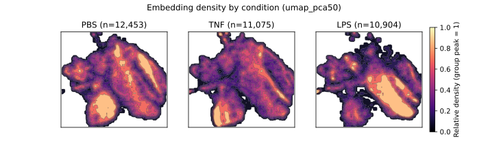](figures/geometry/relative_density.svg)

[Full-size original figure](figures/geometry/relative_density.svg) · [Original plot metadata](metadata/geometry/relative_density.json)

## annotation associations

`scgeo.pl.state_flow_alluvial` — Same-cell associations; captured cells are not independent biological samples

[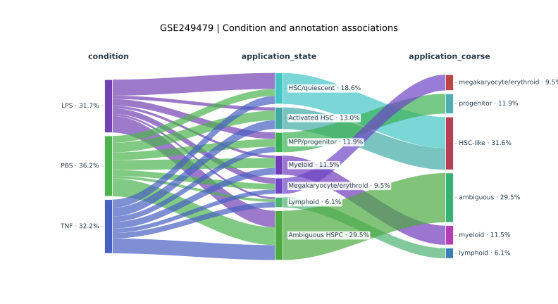](figures/geometry/annotation_associations.svg)

[Full-size original figure](figures/geometry/annotation_associations.svg) · [Original plot metadata](metadata/geometry/annotation_associations.json)

## PBS vs TNF evidence

`scgeo.pl.state_evidence_panel` — Frozen descriptive displacement; no biological replication

[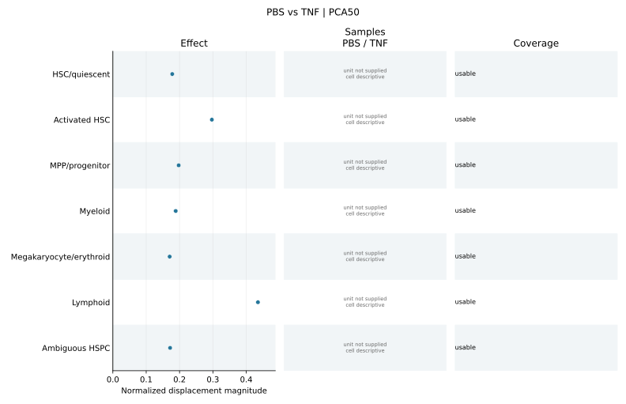](figures/geometry/PBS_vs_TNF_evidence.svg)

[Full-size original figure](figures/geometry/PBS_vs_TNF_evidence.svg) · [Original plot metadata](metadata/geometry/PBS_vs_TNF_evidence.json)

## PBS vs LPS representation matrix

`scgeo.pl.robustness_matrix` — Stored scalar magnitudes; representations not independent

[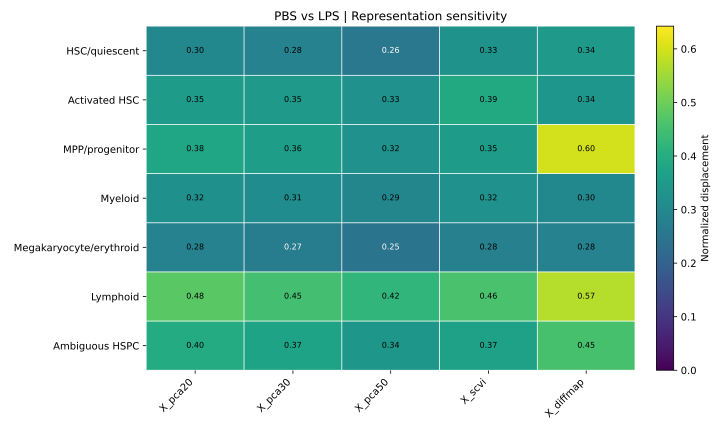](figures/geometry/PBS_vs_LPS_representation_matrix.svg)

[Full-size original figure](figures/geometry/PBS_vs_LPS_representation_matrix.svg) · [Original plot metadata](metadata/geometry/PBS_vs_LPS_representation_matrix.json)

## PBS vs TNF composition pies

`scgeo.pl.paga_shift_map` — PAGA-style renderer of descriptive pooled neighbor adjacency, not PAGA inference; captured-cell composition

[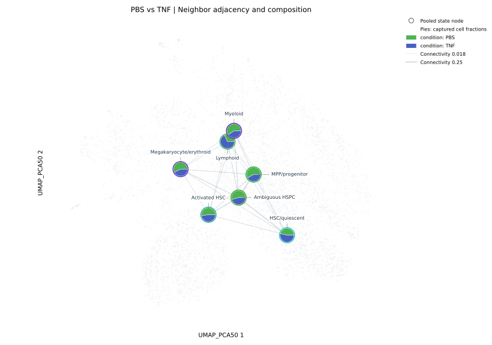](figures/geometry/PBS_vs_TNF_composition_pies.svg)

[Full-size original figure](figures/geometry/PBS_vs_TNF_composition_pies.svg) · [Original plot metadata](metadata/geometry/PBS_vs_TNF_composition_pies.json)

## PBS vs TNF compass

`scgeo.pl.recovery_compass` — Frozen descriptive displacement; no biological replication; alignment/OOD absent; connectors show display means, not quantitative displacements; graph is descriptive adjacency

[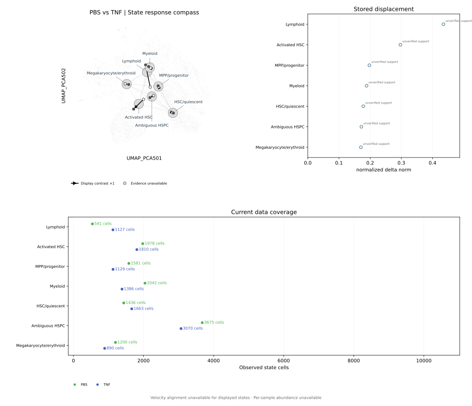](figures/geometry/PBS_vs_TNF_compass.svg)

[Full-size original figure](figures/geometry/PBS_vs_TNF_compass.svg) · [Original plot metadata](metadata/geometry/PBS_vs_TNF_compass.json)

## PBS vs LPS atlas

`scgeo.pl.geometry_dynamics_atlas` — Observed states and frozen descriptive evidence; no velocity or graph panel

[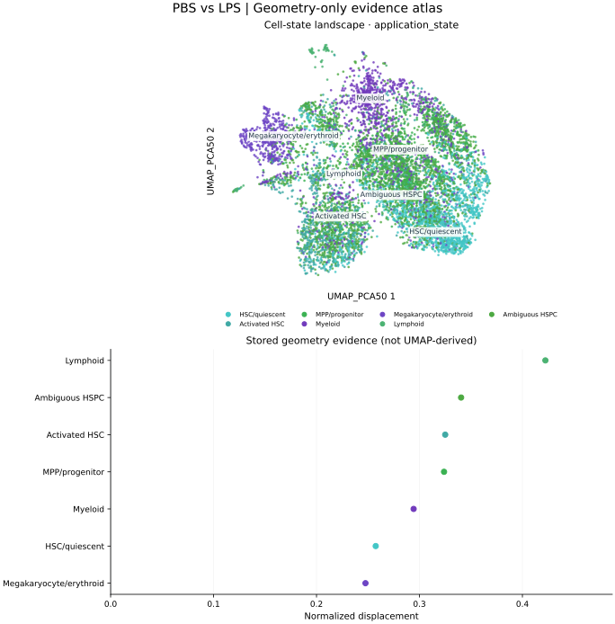](figures/geometry/PBS_vs_LPS_atlas.svg)

[Full-size original figure](figures/geometry/PBS_vs_LPS_atlas.svg) · [Original plot metadata](metadata/geometry/PBS_vs_LPS_atlas.json)

## B TNF 01 gene curves

`scgeo.pl.shift_curves` — Pooled descriptive attribution; no biological replicates; verified_frozen_pca50_coordinates; geometric accounting, not causal regulation

[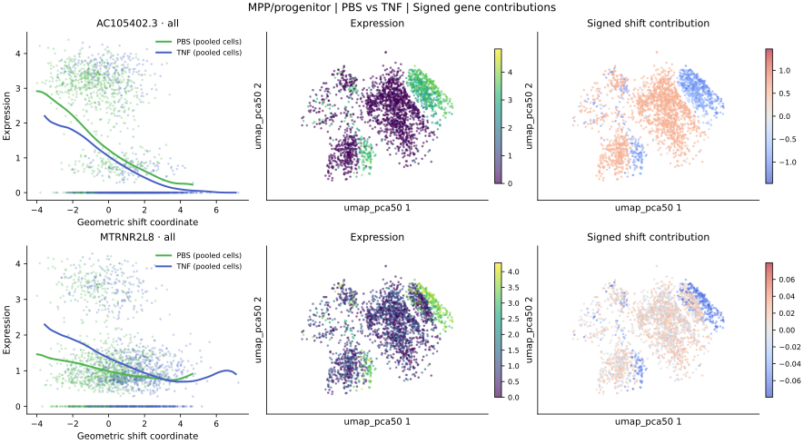](figures/molecular/B_TNF_01_gene_curves.svg)

[Full-size original figure](figures/molecular/B_TNF_01_gene_curves.svg) · [Original plot metadata](metadata/molecular/B_TNF_01_gene_curves.json)

## B TNF 01 program curves

`scgeo.pl.shift_curves` — Pooled descriptive attribution; no biological replicates; verified_frozen_pca50_coordinates; geometric accounting, not causal regulation; overlapping program sums are not percentages

[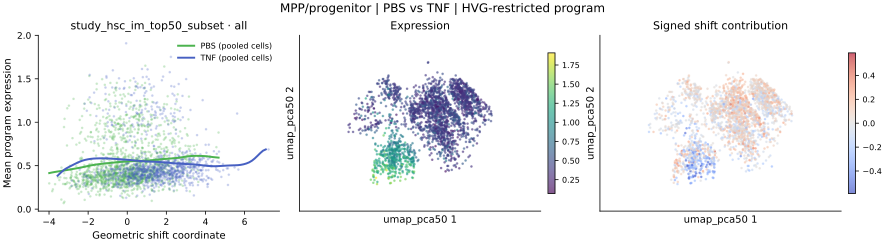](figures/molecular/B_TNF_01_program_curves.svg)

[Full-size original figure](figures/molecular/B_TNF_01_program_curves.svg) · [Original plot metadata](metadata/molecular/B_TNF_01_program_curves.json)

## B TNF 01 shift embedding

`scgeo.pl.shift_embedding` — Pooled descriptive attribution; no biological replicates; verified_frozen_pca50_coordinates; geometric accounting, not causal regulation; connector is not a lineage or RNA velocity

[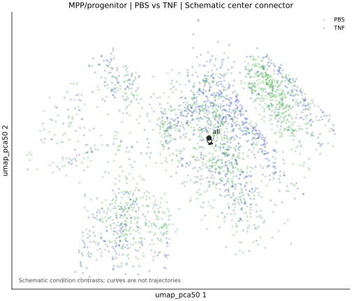](figures/molecular/B_TNF_01_shift_embedding.svg)

[Full-size original figure](figures/molecular/B_TNF_01_shift_embedding.svg) · [Original plot metadata](metadata/molecular/B_TNF_01_shift_embedding.json)

## B LPS 01 gene curves

`scgeo.pl.shift_curves` — Pooled descriptive attribution; no biological replicates; verified_frozen_pca50_coordinates; geometric accounting, not causal regulation

[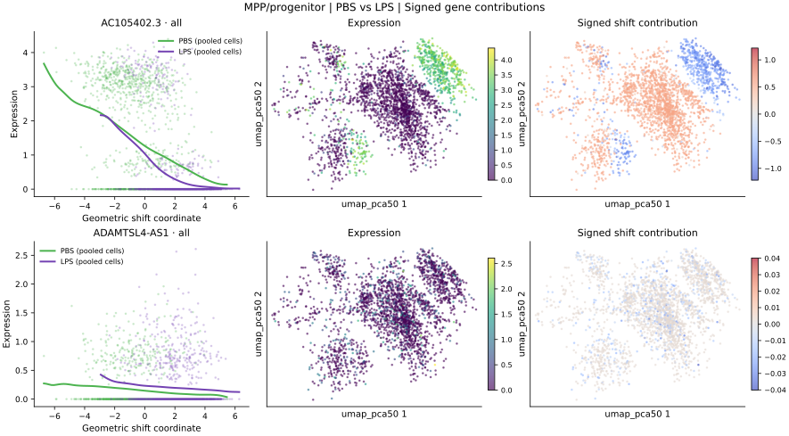](figures/molecular/B_LPS_01_gene_curves.svg)

[Full-size original figure](figures/molecular/B_LPS_01_gene_curves.svg) · [Original plot metadata](metadata/molecular/B_LPS_01_gene_curves.json)

## B LPS 01 program curves

`scgeo.pl.shift_curves` — Pooled descriptive attribution; no biological replicates; verified_frozen_pca50_coordinates; geometric accounting, not causal regulation; overlapping program sums are not percentages

[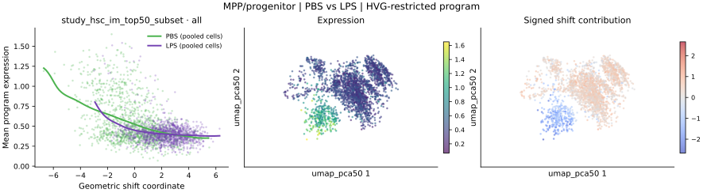](figures/molecular/B_LPS_01_program_curves.svg)

[Full-size original figure](figures/molecular/B_LPS_01_program_curves.svg) · [Original plot metadata](metadata/molecular/B_LPS_01_program_curves.json)

## B LPS 01 shift embedding

`scgeo.pl.shift_embedding` — Pooled descriptive attribution; no biological replicates; verified_frozen_pca50_coordinates; geometric accounting, not causal regulation; connector is not a lineage or RNA velocity

[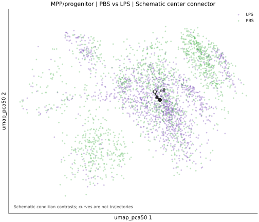](figures/molecular/B_LPS_01_shift_embedding.svg)

[Full-size original figure](figures/molecular/B_LPS_01_shift_embedding.svg) · [Original plot metadata](metadata/molecular/B_LPS_01_shift_embedding.json)

