# GSE280305 — native ScGeo 0.2.1 plots on public data

[Results-first notebook](GSE280305_native_results.ipynb) · [Native plotting workflow](../../v0.2.0/08_gse280305_native_visualization.ipynb) · [Execution guide](../../v0.2.0/GSE280305_NATIVE_PLOTS.md) · [GEO dataset](https://www.ncbi.nlm.nih.gov/geo/query/acc.cgi?acc=GSE280305)

These are the actual, unchanged SVG exports from the successful native plotting notebook, not custom reconstructions. The recovered checkpoint contains 31,605 cells, 3,000 retained HVGs and 14 original clusters across D8, D11, D14 and D21. D8 is an already-irradiated reference; there is one recorded library per time point, without verified biological replicate identities. The comparisons are descriptive. No trajectory, causal mechanism, velocity field or biological-sample uncertainty is inferred.

All eight native plotting APIs and eleven figure calls completed on ScGeo 0.2.1 candidate `683228b1c52808d3cc5df2de5f6e104932c29328`. Every call returned a native `PlotResult` and exported figures and provenance. Open any full-size SVG to inspect detail. Selected genes are retrospective examples of signed scaled-HVG accounting, not independently validated drivers.

## Native figure gallery

### Matched time-point facets: original raw UMAP

`scgeo.pl.embedding_facets()` — Four post-irradiation time points on the original raw UMAP, with shared within-figure limits.

[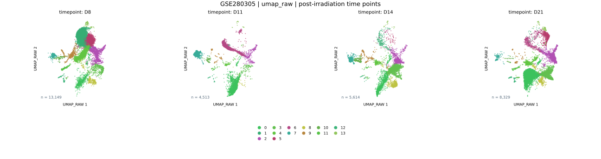](figures/01_facets_umap_raw.svg)

[Full-size native SVG](figures/01_facets_umap_raw.svg) · [Original plot metadata](metadata/01_facets_umap_raw.json)

### Matched time-point facets: Scanorama UMAP

`scgeo.pl.embedding_facets()` — The same time points on the original integrated UMAP. Coordinates are not directly comparable with the raw UMAP.

[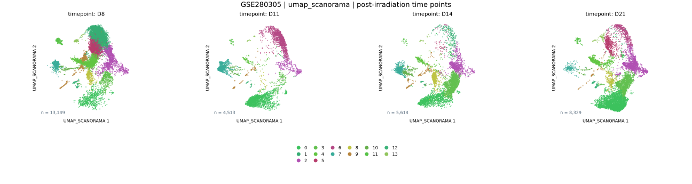](figures/01_facets_umap_scanorama.svg)

[Full-size native SVG](figures/01_facets_umap_scanorama.svg) · [Original plot metadata](metadata/01_facets_umap_scanorama.json)

### Representation stability

`scgeo.pl.representation_stability_heatmap()` — Stored D8–D21 normalized displacement in the two representations, with consensus classes and full-roster local diagnostic flags.

[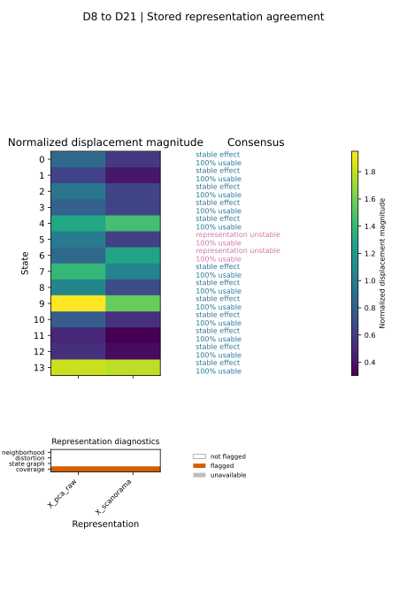](figures/02_representation_heatmap.svg)

[Full-size native SVG](figures/02_representation_heatmap.svg) · [Original plot metadata](metadata/02_representation_heatmap.json)

### Consensus state map

`scgeo.pl.consensus_state_map()` — Stored consensus classes displayed on Scanorama UMAP. Twelve clusters are stable-effect and two representation-unstable under the declared rules.

[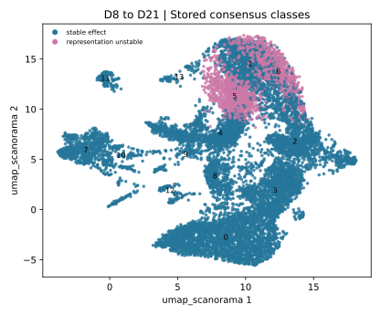](figures/03_consensus_map.svg)

[Full-size native SVG](figures/03_consensus_map.svg) · [Original plot metadata](metadata/03_consensus_map.json)

### Local neighborhood preservation

`scgeo.pl.local_distortion_map()` — Cluster-median shared-neighbor fraction at k=15, assessed across all four time points; colors are not per-cell estimates.

[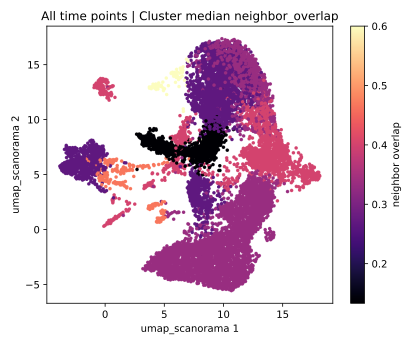](figures/04_neighbor_overlap.svg)

[Full-size native SVG](figures/04_neighbor_overlap.svg) · [Original plot metadata](metadata/04_neighbor_overlap.json)

### Local shape distortion

`scgeo.pl.local_distortion_map()` — Cluster-median local shape distortion, assessed across all four time points at k=15.

[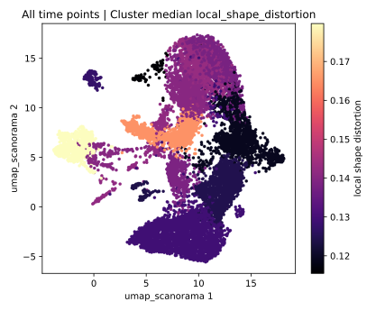](figures/04_local_shape_distortion.svg)

[Full-size native SVG](figures/04_local_shape_distortion.svg) · [Original plot metadata](metadata/04_local_shape_distortion.json)

### State evidence panel

`scgeo.pl.state_evidence_panel()` — D8–D21 normalized raw-PCA effects and representation agreement, with full-roster local diagnostics. No biological confidence intervals.

[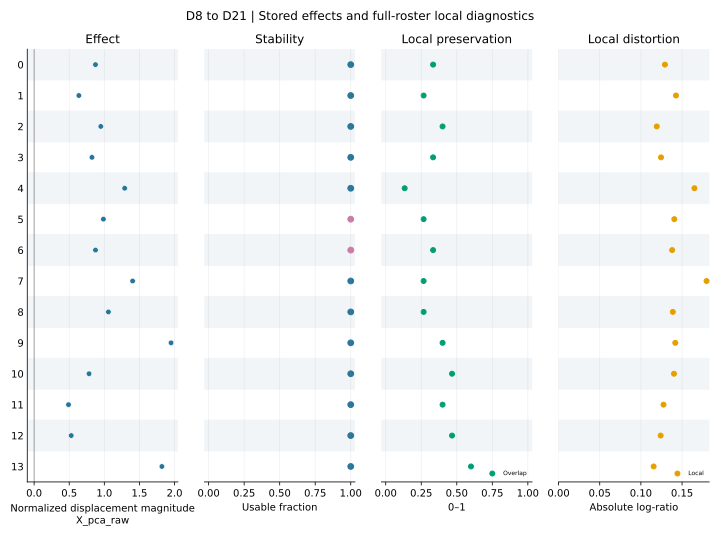](figures/05_evidence_panel.svg)

[Full-size native SVG](figures/05_evidence_panel.svg) · [Original plot metadata](metadata/05_evidence_panel.json)

### Adaptive geometry/evidence atlas

`scgeo.pl.geometry_dynamics_atlas()` — Native adaptive layout combining observed states and stored effects; no velocity panel. Two categories are omitted from the visible legend, as noted in the figure and metadata.

[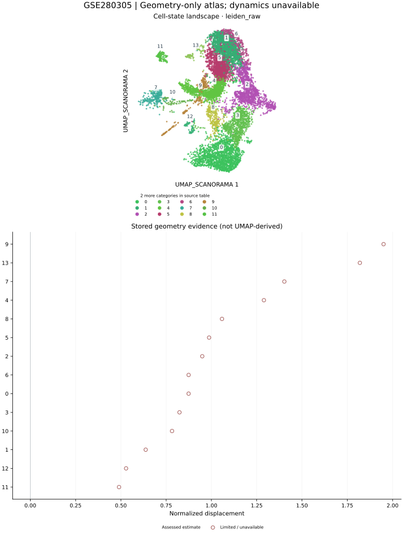](figures/06_adaptive_atlas.svg)

[Full-size native SVG](figures/06_adaptive_atlas.svg) · [Original plot metadata](metadata/06_adaptive_atlas.json)

### Molecular shift curves: cluster 4

`scgeo.pl.shift_curves()` — Selected Nfkbia and Junb curves and expression/contribution maps, with pooled cell support.

[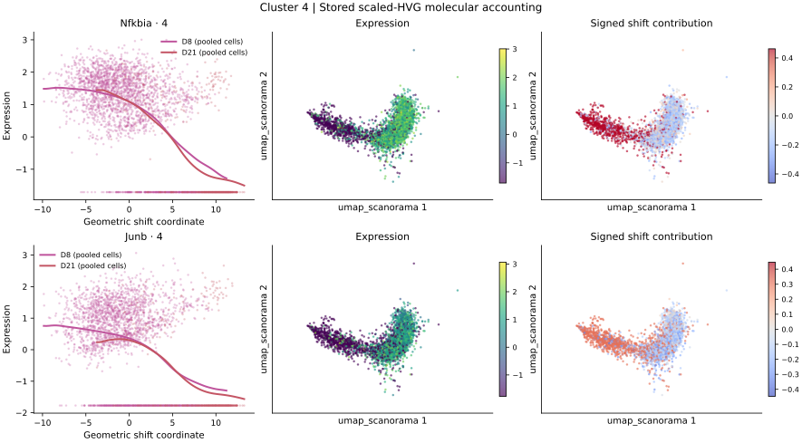](figures/07_shift_curves_cluster_4.svg)

[Full-size native SVG](figures/07_shift_curves_cluster_4.svg) · [Original plot metadata](metadata/07_shift_curves_cluster_4.json)

### Molecular shift curves: cluster 9

`scgeo.pl.shift_curves()` — Selected Jchain and Mzb1 curves and expression/contribution maps, with pooled cell support.

[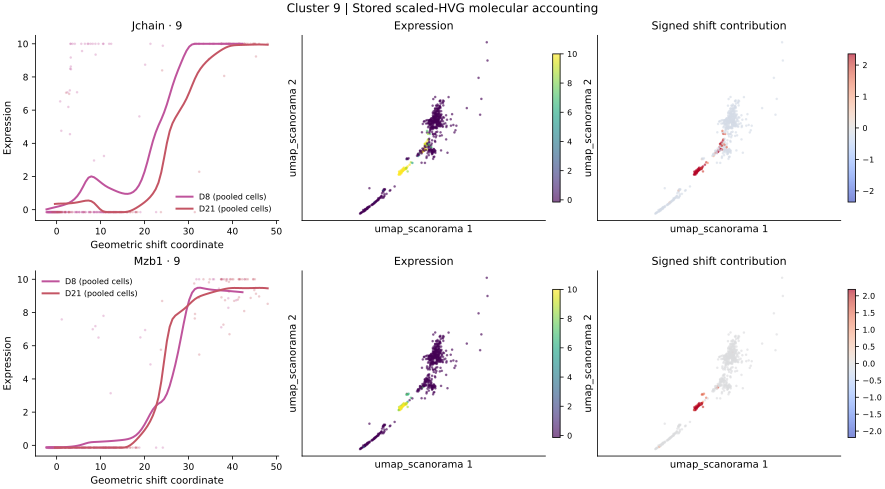](figures/07_shift_curves_cluster_9.svg)

[Full-size native SVG](figures/07_shift_curves_cluster_9.svg) · [Original plot metadata](metadata/07_shift_curves_cluster_9.json)

### Schematic shift connectors

`scgeo.pl.shift_embedding()` — Weighted condition-center connectors for clusters 4 and 9, not trajectories or velocity.

[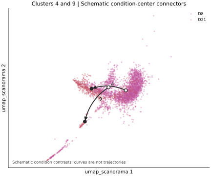](figures/08_shift_embedding.svg)

[Full-size native SVG](figures/08_shift_embedding.svg) · [Original plot metadata](metadata/08_shift_embedding.json)

## Reproducibility and audit

- Native application source: companion commit `a82fe2856d5d263aa981b86c5914073e73e4f0f4`; ScGeo commit `683228b1c52808d3cc5df2de5f6e104932c29328`.
- Original H5AD SHA256: `c5d32591abad3d659277a20a5f8681602b55fd849d0bd0e2329c1b4fd6122bee`.
- Uploaded review archive SHA256: `f39918f577ecbdbe906cd55db3aeed33be6d703ca0a2e5efc3170816aaffcc86`.
- Original [run manifest](native_plot_manifest.json) SHA256: `310b761ec78b84a3430e12885c4f38f68e4140ff04a35786108456ccbba0a664`.
- All 34 supplied payload hashes (22 image files, 11 plot JSON files and one aggregate state report) match the manifest. All 11 PNGs were visually reviewed; SVGs were checked for well-formed XML and embedded/local references. The layout review noted generous whitespace in the heatmap and atlas; the wide facets benefit from full-size viewing.
- The complete run reports 33 figure files and 40 plot source tables. PDFs and full plot source CSVs were not supplied in this review archive, so their contents were not independently checked here. They are not committed. The original manifest and plot metadata retain their names and hashes for provenance; they are not a list of files available in this gallery.
- [state_report.csv](state_report.csv) retains all 14 D8–D21 state-level rows. The full-roster local diagnostics are not contrast-specific. The molecular plotting prerequisite matched 42,000 reviewed gene rows and 14 state explanations as recorded by the executed workflow. No missing velocity or biological replicate information was fabricated.

Run the results-first notebook with Python and IPython/Jupyter; no H5AD or ScGeo installation is required. It verifies the gallery's exact file hashes before displaying the native SVGs. Re-run the full native application with the verified local inputs to regenerate PlotResult exports; the viewer does not recompute or redraw them.
